# Nestify


Nestify is a house rental platform with two sides. Agents list and manage properties, and users browse, shortlist, chat with agents, and pay.

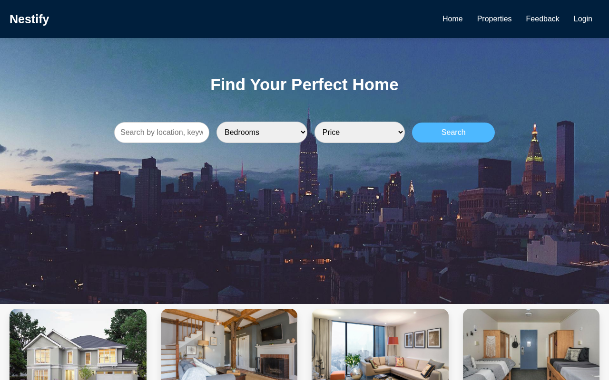

---

## Features

**For users**
- Search properties by location, bedrooms, and price
- Save properties to favorites and a cart
- Chat with an agent and message them about a property
- Pay for a property and view payment history
- Sign up with email OTP verification, plus forgot-password and reset flows

**For agents**
- List, edit, and delete properties with photos
- Read and reply to user messages and chats
- Sign up with OTP verification and log in to a dedicated dashboard

---

## Screenshots

| | |
|---|---|
| 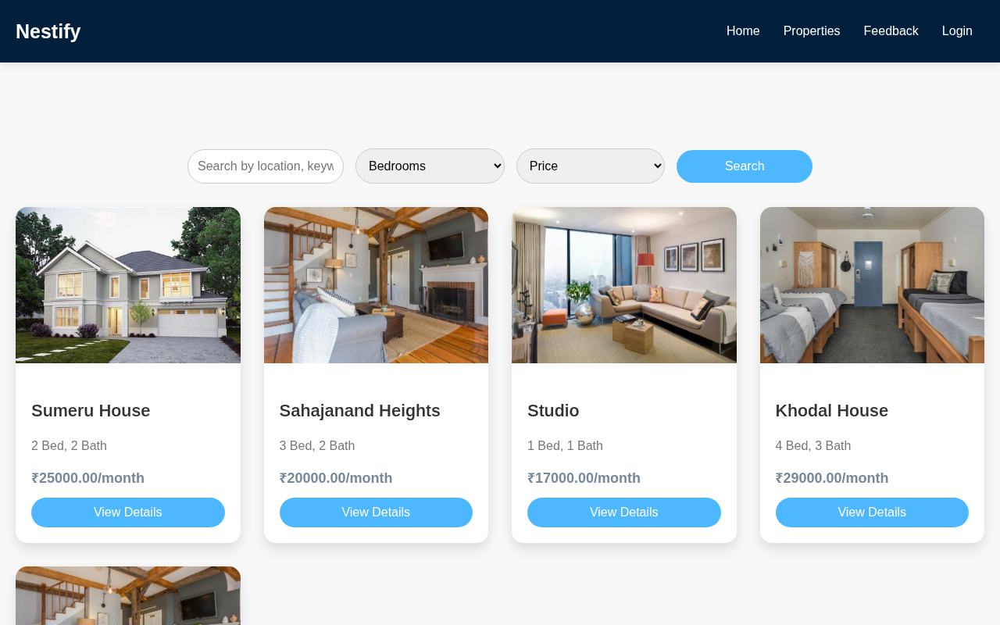<br>*Property listings* | 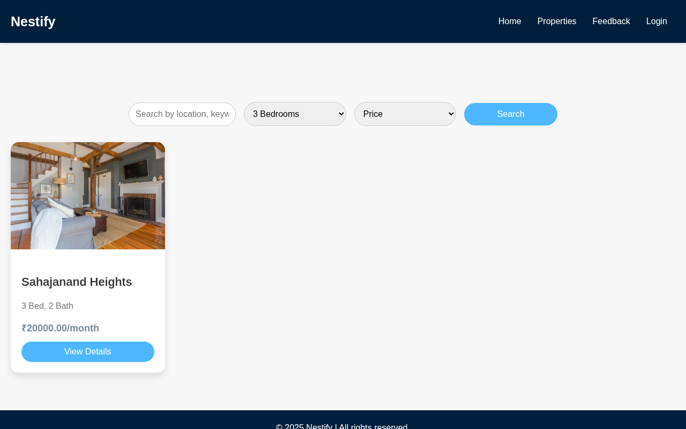<br>*Filtered search* |
| 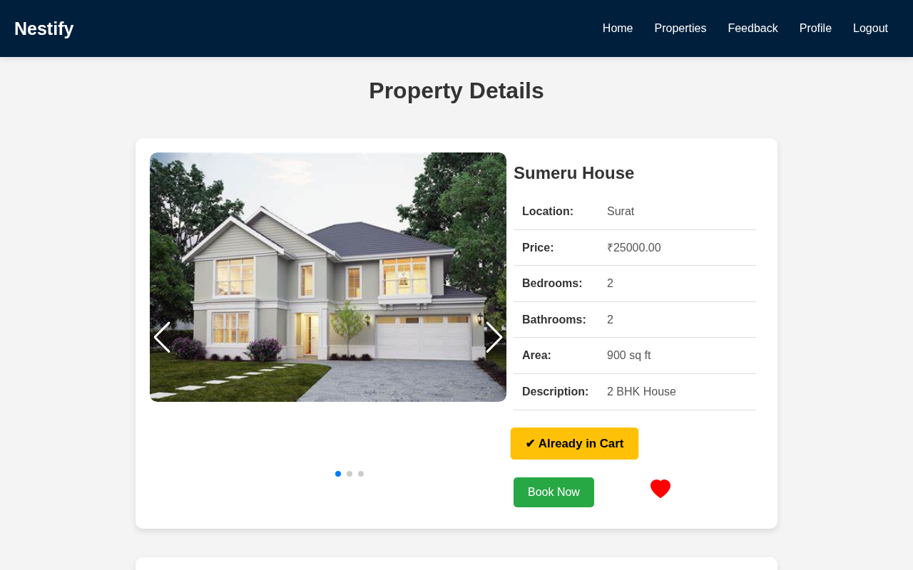<br>*Property detail* | 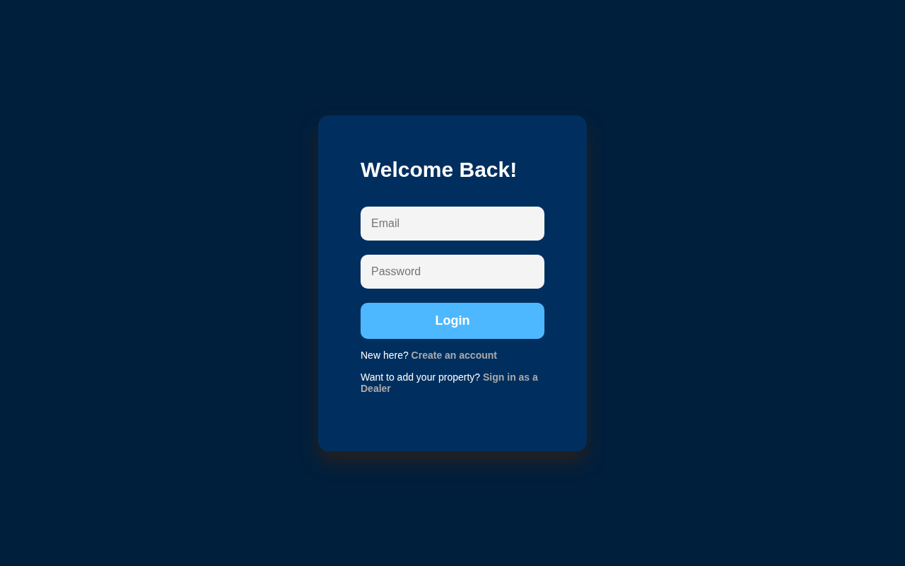<br>*User login* |
| 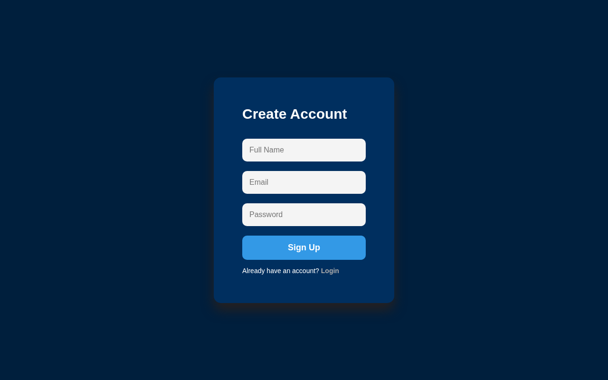<br>*Signup* | 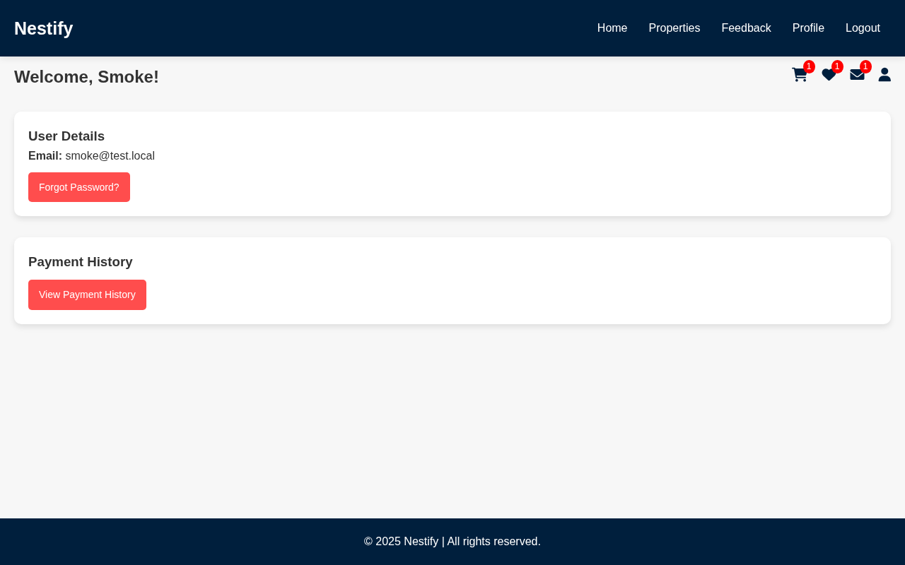<br>*User dashboard* |
| 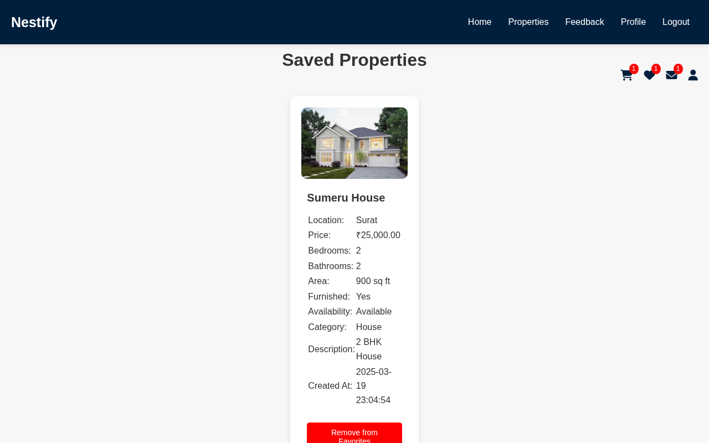<br>*Favorites* | 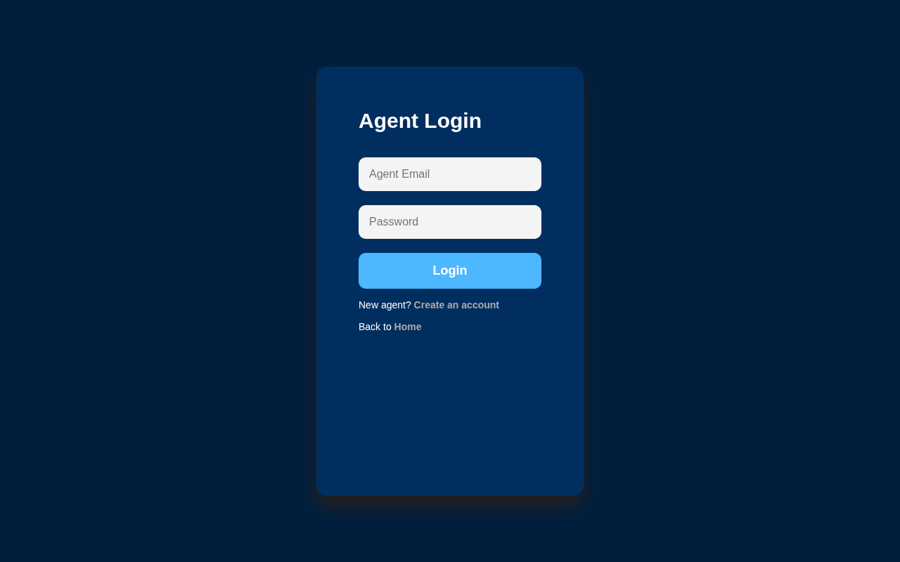<br>*Agent login* |
| 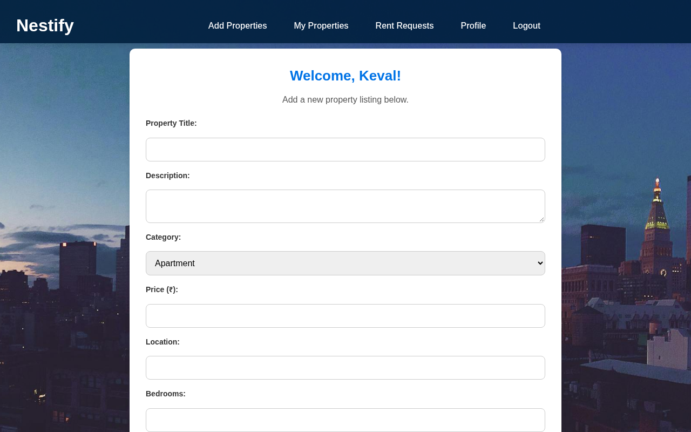<br>*Add a property* | 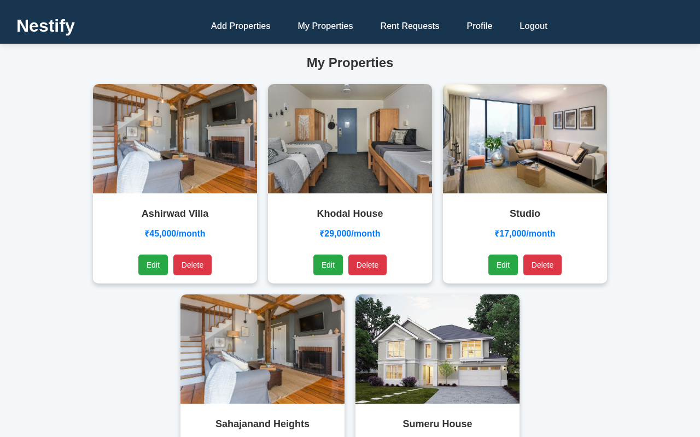<br>*Agent: my properties* |

---

## Tech Stack

| Layer | Technologies |
|---|---|
| Backend | PHP 8 with a small front router and prepared statements (mysqli) |
| Database | MySQL or MariaDB |
| Email | PHPMailer over SMTP, installed with Composer |
| Frontend | HTML, CSS, JavaScript, jQuery |
| Config | `.env` file |

---

## Getting Started

```bash
composer install
cp .env.example .env                 # fill in DB_* and EMAIL_USER / EMAIL_PASS (a Gmail app password)
mysql -u root -e "CREATE DATABASE nestify"
mysql -u root nestify < database/nestify.sql
php -S localhost:8000 -t public public/index.php
```

Open http://localhost:8000. It redirects to the user home page, and agents start at `/Agent/Frontend_Login.php`. With Apache, point `DocumentRoot` at `public/`.

> On Linux, set `lower_case_table_names=1` in MySQL or MariaDB, because the code uses mixed-case table names. XAMPP on Windows already works this way.

---

## Project Structure

```
public/          web root: index.php (front router), .htaccess, assets/, uploads/
app/
  Controllers/   form and AJAX handlers, split into Agent/ and User/
  Models/        Database.php (prepared-statement helper)
  Views/         agent/, user/, shared/ (shared OTP page and partials)
config/          bootstrap, database connection, mail settings (read from .env)
database/        nestify.sql
```

Old URLs such as `/User/Home.php` and `/Agent/AgentDashboard.php` still work through the router. See `MIGRATION.md` for the full restructure notes.

---

## Known Issue

The `payments` table in the dump has no auto-increment id, so checkout fails until you run:

```sql
ALTER TABLE payments ADD PRIMARY KEY (id), MODIFY id INT NOT NULL AUTO_INCREMENT;
```

## License

MIT, see [LICENSE](LICENSE).
